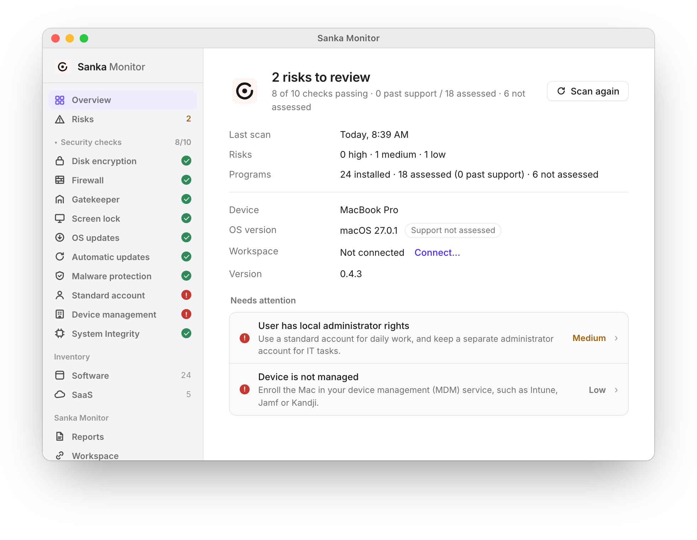

<div align="center">


# Sanka Monitor

The free, open source app that finds the IT risks on a computer: security settings
that are off, an OS or programs past the end of vendor support, and the SaaS and AI
tools in use. It scans locally, needs no account, and nothing leaves the computer
unless you send a report or your company connects it. For macOS and Windows, with
an optional console for IT at [monitor.sanka.com](https://monitor.sanka.com).

[](https://github.com/sankaHQ/monitor/releases/latest)
[](https://sanka.com/monitor/download/)
[](LICENSE)
[](https://sanka.com/monitor/download/)

**[Download for Mac](https://sanka.com/monitor/download/mac)** ·
**[Download for Windows](https://sanka.com/monitor/download/windows)** ·
[All downloads](https://sanka.com/monitor/download/)

<br>



</div>

---

## Why Sanka Monitor?

- **See the risks in seconds**: the first scan runs as soon as the app opens and
  lists what needs attention, highest first, each with one clear fix
- **Every check explained**: disk encryption, firewall, Gatekeeper or SmartScreen,
  screen lock, OS and automatic updates, malware protection, admin rights, device
  management, and SIP or Secure Boot, each with its status, why it matters and
  Re-run
- **Programs past vendor support**: installed software is checked against the
  lifecycle catalog bundled in the app, with the end-of-support date and a successor
- **Shadow IT and shadow AI**: the SaaS and AI tools in use, from installed apps (and
  your browsers' history only if you turn that on), judged against your company's
  allowlist
- **Local by default**: no account, no admin rights, no background service, no
  macOS privacy prompt. The only automatic request is the update check, and it
  sends nothing about the computer
- **English and Japanese**: the app, its menus and its reports follow your
  computer's language, and you can switch in Settings
- **Reports your IT team can use**: an Excel IT asset ledger (IT資産台帳), a
  one-page risk report and CSV, in English or Japanese
- **Built for IT when you need it**: connect computers to a workspace with an
  invite link, a company sign-in, or silently through Jamf, Kandji or Intune
- **Open source**: Apache-2.0, signed and notarized builds, every release file with
  a SHA-256 and a build-provenance attestation

## Get started

1. **Download** the app for [Mac](https://sanka.com/monitor/download/mac) (Apple
   silicon; [universal build for Intel Macs](https://sanka.com/monitor/download/mac-universal))
   or [Windows](https://sanka.com/monitor/download/windows) (x64).
2. **Install**: on a Mac, drag Sanka Monitor into Applications; on Windows, run the
   installer (no admin rights needed).
3. **Open it.** The scan starts at once. Review the risks on **Overview**, open any
   security check for why it matters and how to fix it, and use **Reports** to save
   the Excel ledger or send the scan to Sanka for an automated analysis.

The app updates itself: a new version downloads in the background and installs
the next time the app restarts. You can turn the update check off under Privacy.

| | Requirement |
| --- | --- |
| macOS | 13 Ventura or later; Apple silicon, or Intel with the universal build |
| Windows | Windows 10 or 11, x64 |
| Account | None. A Sanka account is needed only to send a report to Sanka |

## Your data

Sanka Monitor reads the computer's security settings, its installed apps and
programs, and its identity (model, OS version, computer name, serial number).
Your browsers' history is read only if you turn on the browser check, and even
then web addresses and page titles are never stored, written to a report or sent.

It never collects window titles, document names, screen contents, keystrokes,
the clipboard, the files on the computer, or how long any app was used. The
**Privacy** page in the app lists everything the app has sent, exactly as sent.
Details are in [How it works](#how-it-works) and [SECURITY.md](SECURITY.md).

## For IT teams

Connect computers to your workspace on monitor.sanka.com for continuous
visibility of security checks and installed software across the fleet.

| Way to connect | Best for |
| --- | --- |
| **Device management** (Jamf Pro, Kandji, Intune): install the app (the signed `.pkg` or DMG on macOS, the MSI on Windows) and place a deployment token | Fleets: nothing for employees to do. See [docs/mdm-deployment.md](docs/mdm-deployment.md) |
| **Invite link** by email or a shareable link | Small teams: one click opens "Connect to your company?" in the app |
| **Sign in with your company** | People who have a Sanka account in the workspace |
| **One-time code** | Help-desk sessions |

Connecting never turns on app-usage sharing: that stays each person's choice, off
by default. For a one-off inventory without connecting anything,
`sanka-monitor-agent scan --out <folder>` writes one CSV per computer and the
workbooks in `templates/fleet/` merge them ([docs/fleet-scan.md](docs/fleet-scan.md)).

## How it works

Sanka Monitor is local-first:

- **Local scan, the default.** No account and no enrollment. The app scans the
  computer, reads the result against the lifecycle catalog bundled in the app
  (`crates/monitor-findings/catalog/`) and shows the risks. It saves an Excel
  workbook in the IT資産台帳 (IT asset ledger) layout, a CSV and a one-page IT risk
  report (HTML, prints to one A4 page), in Japanese or English, where the person
  chooses. Nothing is uploaded. The only automatic network request is the hourly
  update check, which downloads `latest.json` from release.sanka.com (or this
  repository's latest release), sends nothing about the computer, and can be turned
  off under Privacy.
- **Send to Sanka, on the person's word.** Sending signs in once with a Sanka
  account in the system browser (`<app base>/desktop/monitor/connect`, PKCE per
  RFC 8252, with the code handed back through `sanka-monitor://auth/callback` or
  pasted). Signing in sends only the one-time code, its verifier, the app version
  and the platform; the device credential stays in the OS keychain. The app builds
  the Excel report from the current scan, or takes an edited Sanka Monitor
  workbook, shows what will be sent (device, risk counts, program counts,
  file name, size and SHA-256; the file is sent as
  `sanka-monitor-report_<date-time>.xlsx`, never under the computer's name) and
  sends those frozen bytes and counts, the app version and, for a scan, its report ID
  and versioned raw observations (OS, measured checks, acknowledgements, installed
  software and service catalog keys) to
  `POST /api/v2/monitor/desktop/reports` with a one-hour token. Sanka's receipt
  carries hashes of both the workbook and observations to compare. The preview
  explains that account creation and submission are free. Sanka processes the private
  submission and automatically shares a minimized result with the sender
  and assigned representative; no manual approval is needed and there is no upload-time
  sales notification. The result
  page is linked from the receipt. The sign-in, each one-hour token request,
  each sent report and sign-out appear in the Privacy pane, with the code, the
  verifier and the device secret hidden. Scanning and local export need no account.
  Edited workbooks have no canonical observations and their automated coverage stays
  unknown. The structured observations omit host/serial and individual use history;
  the original workbook can still contain identifiers, so inspect it before sending.
- **The SaaS the computer uses.** Each scan maps installed desktop apps (Slack,
  Zoom, ChatGPT, …) to their SaaS in the catalog bundled in the app
  (`crates/monitor-saas/catalog/saas.json`: product, vendor, category, AI flag, web
  hosts, desktop-app identifiers, and the Sanka migration page and connector). The
  **browser check** is off until the person turns it on: then scans read the Chrome,
  Edge and Firefox history files on the computer (Safari only where Full Disk
  Access is already granted; the app never asks for it), match host names against
  the catalog and keep per SaaS only the last day used and the days used in the
  last 30. Web addresses, page titles and the rest of the history are not stored,
  never written to a report and never sent. A **company allowlist** (JSON; chosen in
  the app, placed by device management, or `--allowlist` on the command line) marks
  each SaaS allowed or not; SaaS not on it become shadow IT / shadow AI risks.
  Optional **regular checks** rescan daily or weekly and nudge in the window and
  the tray when something new appears. By default none of this leaves the computer:
  the SaaS list goes out inside a report the person saves or sends, or, on a
  connected PC whose person turns on SaaS sharing, as each SaaS used in the last 30
  days and the last day it was used (`POST /api/v2/monitor/agent/saas`, listed in the
  Privacy pane). The workspace console shows only how many PCs use each SaaS; the
  company's allowlist set there reaches connected PCs with each check-in.
- **Fleet scan.** `sanka-monitor-agent scan --out <folder>` writes one CSV per PC
  for device management tools, and the workbooks in `templates/fleet/` merge a
  folder of them with Power Query. See [docs/fleet-scan.md](docs/fleet-scan.md).
- **Connected mode, opt-in.** Connecting to a workspace on monitor.sanka.com sends
  the security checks and installed software with each check-in, for continuous
  visibility. A computer connects with an invite link (`sanka-monitor://enroll?invite=…`,
  which shows who it's from first), by signing in with the company account, with a
  one-time code, or silently through device management: a deployment token in managed
  preferences ([docs/mdm-deployment.md](docs/mdm-deployment.md)). Each enrollment sends
  a salted SHA-256 of the hardware id so the workspace replaces the computer's earlier
  device; the id itself never leaves the computer. Device management can connect a
  computer, but never turns on app-usage sharing.
- **Usage, connected and opted in only.** App usage is recorded only while the
  device is connected *and* the person has turned sharing on (default off); the
  app aggregates it into UTC calendar dates before upload. The server stores only
  app/device/date facts, never focus intervals or durations. A local acknowledgement
  ledger suppresses repeat uploads for an app/day even after restarting the app. Release the daily-usage
  API before agent 0.4.2; earlier interval uploads are refused until the agent updates.
- **Lifecycle coverage.** Overview, the send preview and HTML/Excel summaries show
  assessed and not-assessed program counts separately. No finding among assessed
  items does not establish that unassessed software or OS versions are safe.
- **Who opened your data, connected only.** Each time an IT admin opens the
  person's daily app presence, the workspace logs it with a reason. The Privacy
  pane lists those views (when, who or "An IT admin", the days viewed, the reason),
  fetched from `GET /api/v2/monitor/agent/person-views` with the device's runtime
  token when the pane opens, never in the background. It keeps working after the
  person stops sharing. A device that is not connected makes no such request.

## Privacy model

Checks (user-level: no admin rights, no root daemon, no macOS privacy prompt; `pass:
null` when a check cannot tell): disk encryption, firewall, Gatekeeper / SmartScreen,
screen lock, pending OS updates, automatic updates, antivirus (XProtect on macOS,
Security Center on Windows), the signed-in user is not a local admin, device management
(MDM; or an Active Directory domain on Windows), Secure Boot (Windows) and System
Integrity Protection (macOS). TPM is not checked: Windows only reports it to admins.

Installed software: the `.app` bundles in `/Applications` (one level of subfolders,
never inside a bundle, no symlinks) and `~/Applications` on macOS; the Uninstall
registry entries (minus system components, child entries and patches) and the user's
Microsoft Store packages on Windows. Each item is a source, an identifier (bundle id,
registry key name or package family), a name, a version and, on Windows, a publisher.

Findings are computed on the device with the rules sanka-api applies to connected
devices (`device_*` and `software_*` finding types, same severities), so a local
report and the console agree. The catalog is ported from the sanka-api lifecycle
seed plus a snapshot of the public `https://sanka.com/lab/eol-catalog.json`.

Connected mode: after each check-in the agent sends the full software snapshot when
it changed, and at least daily (the workspace's `uploadIntervalSeconds`).

Structurally minimal telemetry: the event types have no fields for window titles, URLs,
document contents, keystrokes, or captures, and inventory items none for install
locations, file names or user names. See the in-app Privacy pane and
`docs/PROVENANCE.md`.

Local data rules: usage is recorded only while the device is enrolled and the
person has opted in, and only usage that started after the person last turned
sharing on is ever uploaded (anything earlier is withheld for good); the device
keeps its own history for 14 days; **Disconnect** revokes the device in the
workspace (`/agent/revoke`, which deletes the usage it received), then wipes that history,
the keychain credential and the login item. Without an answer the wipe happens anyway and
only the credential and the login item stay, to retry the revoke hourly and after a
restart until the workspace confirms. A device the workspace revoked, or
no longer knows (`MONITOR_DEVICE_REVOKED` / `MONITOR_DEVICE_INVALID`), wipes itself the
same way. The workspace's kill switch stops collection and uploads (check-ins continue
without posture or software, to learn when it lifts), and a version below the
workspace's minimum stops uploads until the self-updater installs a newer build. A
connected agent opens at login in the tray (`--background`).

Backend surface: `/api/v2/monitor/agent/*` in sanka-api (enroll → token →
check-in; devices registry at `/api/v2/monitor/devices`), landing in
sankaHQ/sanka-api#3585. Spec: `sanka-project/docs/products/monitor-desktop-agent-implementation-spec.md`.

## Layout

```
apps/agent/              Monitor: Tauri v2 shell (tray, windows, updater, deep-link), the local
                         scan and the `scan` command line, + small React UI
crates/monitor-core      Shared types, ids, API constants, privacy invariants
crates/monitor-findings  The bundled lifecycle catalog and the on-device finding rules
crates/monitor-report    Local reports: IT asset ledger (xlsx), CSV, one-page report (HTML), JA/EN
crates/monitor-saas      The bundled SaaS catalog, desktop-client mapping, the opt-in browser check,
                         the company allowlist
crates/monitor-inventory Installed software (macOS app bundles; Windows Uninstall registry + Store)
crates/monitor-posture   Posture trait + per-platform checks (macOS, Windows)
crates/monitor-usage     Focus tracking + idle detection (pure interval state machine)
crates/monitor-store     Local event queue (in-memory now; SQLite WAL in P2)
crates/monitor-sync      Agent API endpoint contract and HTTP client
templates/fleet/         Excel workbooks (Power Query) that merge a folder of per-PC CSVs
```

## Develop

Requirements: Rust (stable), Node 24+, Xcode command line tools.

```bash
(cd apps/agent && npm ci && npm run build)       # generate_context reads dist/: build before cargo
cargo test --workspace                           # from repo root
(cd apps/agent && npm run tauri dev)             # run Monitor with hot reload
cargo run -p monitor-report --example sample_reports -- /tmp/r   # sample reports, no scan
python3 templates/fleet/build_fleet_template.py  # rebuild the fleet workbooks
```

The lifecycle catalog is data: refresh the public EOL snapshot with
`curl -fsS https://sanka.com/lab/eol-catalog.json -o crates/monitor-findings/catalog/eol-catalog.json`
and keep `rules.json` in step with the sanka-api lifecycle seed.

`cargo fmt --all` and `cargo clippy --workspace --all-targets -- -D warnings` must be
clean; CI enforces both.

## Release

Releases are published from this repository, so the source and the binaries come
from the same place. Signing and notarization secrets are Actions secrets only,
never committed.

`Release (macOS + Windows)` (`.github/workflows/release.yml`, manual dispatch) builds
and signs everything and publishes it as release `vX.Y.Z`, this repository's latest
release, and on `https://release.sanka.com/monitor/`:

- **macOS, Apple silicon (arm64):** the default download, signed with the Developer ID,
  notarized and stapled.
- **macOS, universal:** the same app for Apple silicon and Intel Macs, for Intel Macs
  and for the `.pkg`.
- **macOS `.pkg`** for device management: the universal app in `/Applications` plus a
  login agent for every person (`apps/agent/pkg/`), signed with the Developer ID
  Installer certificate, notarized and stapled. See [docs/mdm-deployment.md](docs/mdm-deployment.md).
  Built only when the three `MACOS_INSTALLER_*` secrets are set; without them the release
  ships without a `.pkg`, and IT deploys the universal DMG.
- **DMGs** are signed, notarized and stapled themselves (Tauri notarizes only the app
  inside), with the Lens layout from `apps/agent/src-tauri/dmg/background.png`.
- **Windows:** the per-user NSIS installer (x64), the download and the update package,
  and a per-machine MSI for device management. Both are Authenticode-signed through
  Microsoft Artifact Signing with the publisher Sanka, Inc. See
  [docs/windows.md](docs/windows.md#release).
- **Every file** is listed with its SHA-256 in `SHA256SUMS` and has a GitHub
  build-provenance attestation (see [SECURITY.md](SECURITY.md#verifying-a-download)).
- **Updates** are signed with Monitor's updater key (the public key is in
  `tauri.conf.json`). `latest.json` points `darwin-aarch64` at the arm64 app,
  `darwin-x86_64` at the universal app and `windows-x86_64` at the installer. The app
  reads it from the CDN first and from this repository's latest release second, stages
  a newer build in the background and installs it when the app restarts or quits, or
  after its window has been closed for 30 minutes (`apps/agent/src-tauri/src/updates.rs`).

The CDN layout and `channels/stable.json`, which `sanka.com/monitor/download/<target>`
follows, are the shared contract in the umbrella repo
(`tracking/monitor-0.4-redesign/contract.md`); `scripts/release_manifest.py` writes
them. `channels/stable.json` is uploaded last, after the files and the GitHub
release, and the run then downloads every file back from the CDN and compares its
SHA-256.

The workflow refuses a tag other than `v` + the version in
`apps/agent/src-tauri/Cargo.toml` (the agent's only version source), and checks that
every secret below exists before any build starts. Publishing runs in the `release`
environment, whose reviewers approve the run; turn on immutable releases and a tag
ruleset for `v*` in the repository settings.

| Actions secret | Used for |
| --- | --- |
| `MACOS_APPLE_CERTIFICATE`, `MACOS_APPLE_CERTIFICATE_PASSWORD`, `MACOS_APPLE_SIGNING_IDENTITY` | Developer ID Application signing |
| `MACOS_INSTALLER_CERTIFICATE`, `MACOS_INSTALLER_CERTIFICATE_PASSWORD`, `MACOS_INSTALLER_SIGNING_IDENTITY` | Developer ID Installer signing (the `.pkg`). Optional: leave all three unset to release without a `.pkg` |
| `MACOS_APPLE_ID`, `MACOS_APPLE_APP_SPECIFIC_PASSWORD`, `MACOS_APPLE_TEAM_ID` | Notarization |
| `TAURI_UPDATER_PRIVATE_KEY`, `TAURI_UPDATER_PRIVATE_KEY_PASSWORD` | Updater signatures (`.sig`) |
| `MONITOR_AZURE_TENANT_ID`, `MONITOR_AZURE_CLIENT_ID`, `MONITOR_AZURE_CLIENT_SECRET` | Windows: the signing credential |
| `MONITOR_AZURE_SIGNING_ENDPOINT`, `MONITOR_AZURE_SIGNING_ACCOUNT`, `MONITOR_AZURE_SIGNING_PROFILE` | Windows: the Artifact Signing account and certificate profile |
| `MONITOR_CDN_ACCESS_KEY_ID`, `MONITOR_CDN_SECRET_ACCESS_KEY`, `MONITOR_CDN_BUCKET` | Publishing: the Tigris bucket behind release.sanka.com |

The bucket is public, with `release.sanka.com` set as its custom domain and a CNAME from
`release.sanka.com` to `<bucket>.t3.tigrisbucket.io`. The S3 endpoint defaults to
`https://t3.storage.dev`; set the repository variable `MONITOR_CDN_ENDPOINT` to use another.
| `MONITOR_RELEASE_APP_CLIENT_ID`, `MONITOR_RELEASE_APP_PRIVATE_KEY` | Publishing the GitHub release: a GitHub App (today the Sanka Change Bot) installed on this repository with Contents read and write, so a release isn't published under a person's name. Every run, dry runs too, checks the app can reach the repository |

A dry run (the default) builds, signs and notarizes everything and uploads the release
files to the workflow run as the artifact `sanka-monitor-vX.Y.Z`. Publishing is the
same run with `dry_run=false`:

```bash
gh workflow run release.yml --repo sankaHQ/monitor -f version=vX.Y.Z -f dry_run=true -f release_notes="<notes>"
gh workflow run release.yml --repo sankaHQ/monitor -f version=vX.Y.Z -f dry_run=false -f release_notes="<notes>"
```

**Releases up to 0.3.x** are on `sankaHQ/monitor-releases`, and those versions check it
for updates. Nothing is published there any more, so they don't update to 0.4.0 by
themselves: reinstall from https://sanka.com/monitor/download/ to move to 0.4.0, which
updates from `release.sanka.com` and this repository.

**Retiring the universal build.** Track Intel Macs through the `arch` that check-ins
now report and through the download page. When they stay below 3% for 60 days, warn
in the app on Intel Macs 90 days ahead, then pin `darwin-x86_64` in `latest.json` to
the last universal build, keep that DMG downloadable and remove the universal matrix
leg (the `.pkg` moves to the arm64 leg).

## License, security and contributing

Sanka Monitor is licensed under the [Apache License 2.0](LICENSE); see [NOTICE](NOTICE)
and [THIRD_PARTY_NOTICES.md](THIRD_PARTY_NOTICES.md). Report vulnerabilities privately
as described in [SECURITY.md](SECURITY.md). To contribute, start with
[CONTRIBUTING.md](CONTRIBUTING.md). The Sanka API and the Monitor console are not part
of this repository.
